  

<h1 align="center">Hi, I'm Orkhan Dzhafarli 👋</h1>

<strong>𝐎𝐑𝐊𝐇𝐀𝐍·𝐃</strong>

  <strong>Full-stack &amp; mobile developer</strong> 
  Flutter apps. Python backends. React frontends. Linux servers. 
  I connect the pieces — from the first idea to a running product.

  
  
  

---

## From idea to deployment

I work across mobile, web, backend, and infrastructure. I build mobile apps with Flutter, APIs with Python, and web interfaces with React — then set up Linux servers and handle deployment.

I enjoy understanding how the whole system fits together and making it work from end to end.

  

> I like knowing what happens after the button is pressed — from the interface to the API, the data, and the server.

<strong>What can we build together? ↗</strong>

| Your starting point | Where I can help |
| :--- | :--- |
| **“I have an app idea.”** | A Flutter mobile app, its backend, and the data behind it. |
| **“I need a web product.”** | A React interface connected to an API. |
| **“I need the pieces to talk.”** | Python APIs, databases, caching, and messaging. |
| **“Now it needs somewhere to run.”** | Linux server setup, Docker, Nginx, and deployment. |

Bring the idea, the unfinished project, or the server that needs setting up. We can start there.

## My stack

### Mobile

  
  

Flutter · Dart

### Backend

  
  
  
  

Python · FastAPI · Pydantic · Laravel

### Frontend

  
  
  
  
  
  
  

React · TypeScript · JavaScript · HTML · CSS · Tailwind CSS · shadcn/ui

### Data & messaging

  
  
  
  
  
  

PostgreSQL · Redis · MySQL · Supabase · Firebase · RabbitMQ

### Linux & deployment

  
  
  
  
  

Linux · Bash · Docker · Nginx · AWS

### Development tools

  
  

Git · Jupyter

## Beyond the code

**[𝐎𝐑𝐊𝐇𝐀𝐍·𝐃 on Telegram ↗](https://t.me/orkhan_d)**

The same name, the same person — my Telegram channel alongside the code.

---

### Have an idea? Let's build it.

Need a mobile app, a web product, or help getting it running on Linux? I'd love to hear what you're working on.

**[Message me on Telegram](https://t.me/d_orkhan)** · [Send an email](mailto:orhan.jafarliev@gmail.com) · [Connect on LinkedIn](https://www.linkedin.com/in/orkhan-dzhafarli-9a6492337/)

